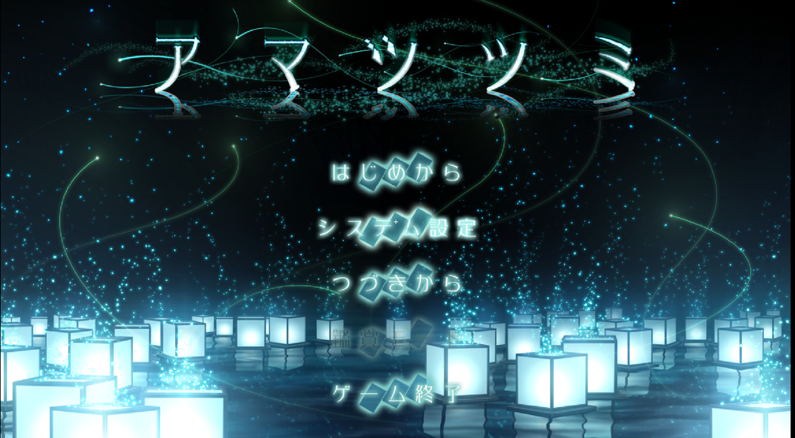
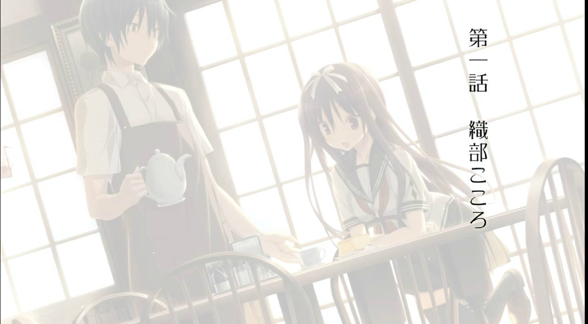
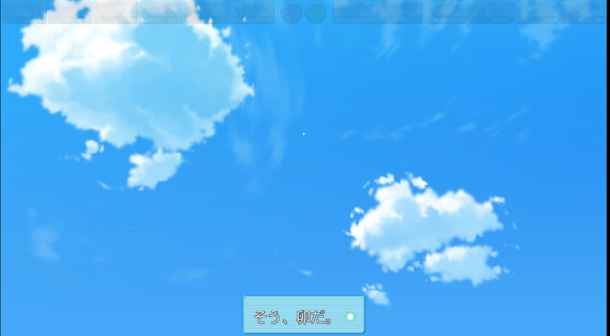

# cmvs-rs Switch Port Enhancements

English | [简体中文](README.md)

This repository is a **Nintendo Switch port-enhancement fork** of
[Shizuku-in/cmvs-rs](https://github.com/Shizuku-in/cmvs-rs).

**Upstream attribution**: the upstream project was created by **gkouen (Shizuku-in)** — a Rust
research and reimplementation of Purple software's CMVS visual-novel engine. All credit for the
engine and its architecture goes to the original author; this fork only adds porting enhancements
on top of the upstream Switch player.

**License**: the upstream project is dual-licensed under MIT OR Apache-2.0, which explicitly
permits modification and redistribution. All new/modified code in this fork stays under the same
dual license; upstream copyright notices, full license texts and third-party notices are retained
in [LICENSE-MIT](LICENSE-MIT), [LICENSE-APACHE](LICENSE-APACHE) and
[THIRD_PARTY_NOTICES.txt](THIRD_PARTY_NOTICES.txt). The Apache-2.0 §4(b) modification notice
lives in [platforms/switch/PORT-ENHANCEMENTS.md](platforms/switch/PORT-ENHANCEMENTS.md).

## Demo (tested on Ryujinx)

Test game: *Amatsutsumi* (Purple software), docked 1080p, 60 FPS.

| Title screen (60.01 FPS) | Chapter start | Dialogue (Shift-JIS Japanese) |
|---|---|---|
|  |  |  |

Full verified chain: title → start → dialogue → quick save/load → NSP direct boot (details in
[platforms/switch/PORT-ENHANCEMENTS.md](platforms/switch/PORT-ENHANCEMENTS.md)).

## What this fork adds

On top of the upstream Switch player (deko3d GPU rendering, multi-game list, encoding
auto-detection — see the upstream repo):

| Enhancement | What it does |
|---|---|
| **Per-game button mapping** | `buttons.txt` remaps the pad per game (pad → engine input codes), with two-key combos; no code changes needed |
| **Save/load hotkeys** | X/Y/ZL+ZR auto-click the game's own save/load/config toolbar; L+X / L+Y host-snapshot quick save/load (slot 860, compatible with the in-game quick save), with OSD feedback |
| **Single-game NSP direct boot** | One NSP per game, boots from the HOME menu like a retail title. Mode A (data bundled) / mode B (2.6 MB stub pointing at SD data) packed by one script with a `pack_check` zero-hard-failure gate |
| **Attract-movie skip fix** | Holding skip during a movie now injects a decide press — the movie stops within 2 frames (headless-probe verified), without touching the shared engine or game scripts |
| **Docked/handheld resolution** | 1080p docked / 720p handheld, switched dynamically |
| **CJK support** | Shift-JIS decoding, CJK paths and game folder names, FAT32/exFAT-save compatible |
| **Docker-less Windows build** | `build-player-win.sh` cross-builds in one step (devkitA64 → ELF → NRO) |

See [platforms/switch/PORT-ENHANCEMENTS.md](platforms/switch/PORT-ENHANCEMENTS.md) (button map,
build guide, fix notes) and [platforms/switch/NSP-PACKING.md](platforms/switch/NSP-PACKING.md)
(NSP packing manual).

## Quick start

Requires Rust 1.89+ stable and devkitA64:

```sh
# Cross-build the NRO (Windows Git Bash)
sh platforms/switch/scripts/build-player-win.sh
```

Put `platforms/switch/build/cmvs-switch.nro` into `switch/cmvs/` on the SD card and your legally
obtained game data into `sdmc:/switch/cmvs/<game>/` (**no game assets are included in or
distributed by this repository**). For NSP packing see
[NSP-PACKING.md](platforms/switch/NSP-PACKING.md).

## Verification status

- ✅ Fully working on Ryujinx 1.3.3 (strict mode): title → start → dialogue → quick save/load → NSP direct boot, 60 FPS
- ✅ NSP direct boot with a real firmware dump, firmware shared-font path, attract-skip fix (headless verified)
- ⏳ Awaiting hardware: touch, audio out, docked/handheld switching on a real console, FAT32/exFAT cards, NSP install under Atmosphere

## Legal boundaries

- **Game data is not part of this repository**: `data/pack/*.cpz`, `*.cmv` etc. are copyrighted by
  Purple software and the respective rights holders. Bring your own legally obtained copy;
  `.gitignore` excludes all game-asset formats.
- **No keys or NSP artifacts in the repo**: dump your own `prod.keys`; pack NSPs yourself with the script.
- Not affiliated with Nintendo or Purple software. NSPs require a hacked console with sigpatches.

## Upstream project

Upstream cmvs-rs also targets Windows / Linux / macOS / iOS / Android / Web / PS Vita. For desktop
builds, CLI tools and the engine research docs, see the
[upstream README](https://github.com/Shizuku-in/cmvs-rs#readme). The generic guides also apply here:
[running guide](docs/guides/running.md) · [CLI guide](docs/guides/cli.md) · [architecture](docs/architecture.md).

## License

[MIT](LICENSE-MIT) OR [Apache-2.0](LICENSE-APACHE) — same dual license as upstream; the license
files are unmodified.
