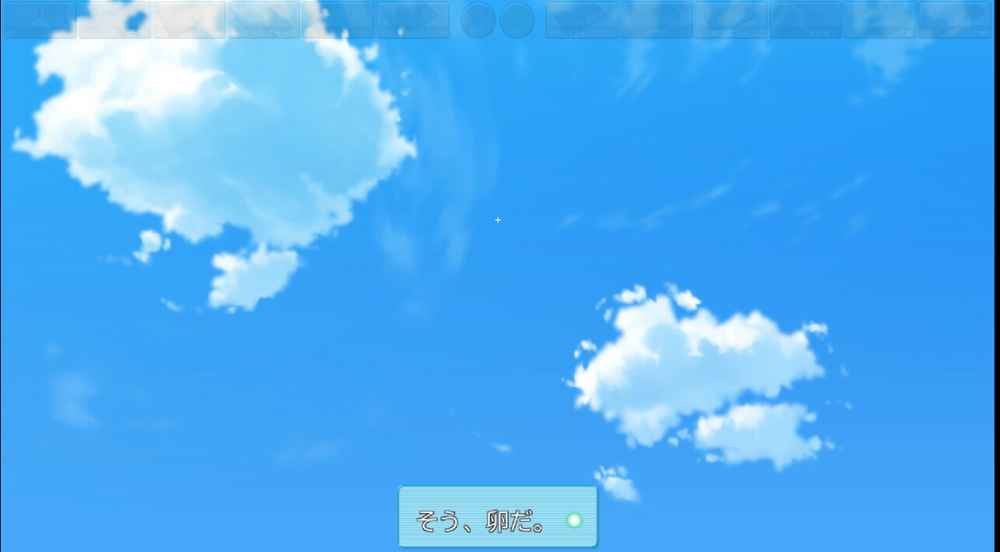

# cmvs-rs Switch 移植增强

简体中文 | [English](README.en.md)

本仓库是 [Shizuku-in/cmvs-rs](https://github.com/Shizuku-in/cmvs-rs) 的 **Nintendo Switch 移植增强 fork**。

**原作者归属**：上游项目由 **gkouen（Shizuku-in）** 开发，用 Rust 研究并重实现 Purple software 的 CMVS 视觉小说引擎。
本 fork 的全部功劳与上游架构均来自原作者，我们仅在其 Switch 播放器之上做了二次移植增强。

**许可说明**：上游采用 MIT OR Apache-2.0 双许可，明确允许修改与再分发。本 fork 的新增/修改代码
沿用同一双许可；上游版权声明、许可证全文与第三方组件声明完整保留于
[LICENSE-MIT](LICENSE-MIT)、[LICENSE-APACHE](LICENSE-APACHE) 与
[THIRD_PARTY_NOTICES.txt](THIRD_PARTY_NOTICES.txt)。按 Apache-2.0 §4(b) 要求的修改声明见
[platforms/switch/PORT-ENHANCEMENTS.md](platforms/switch/PORT-ENHANCEMENTS.md)。

## 演示（Ryujinx 实测截图）

测试游戏：《アマツツミ》（天津罪，Purple software），底座模式 1080p，60 FPS。

| 标题画面（60.01 FPS） | 开始游戏（章节卡） | 对话渲染（Shift-JIS 日文） |
|---|---|---|
|  |  |  |

完整实测链路：标题 → 开始 → 对话 → 快速存/读档 → NSP 直启，全部通过（证据与 FPS 见
[platforms/switch/PORT-ENHANCEMENTS.md](platforms/switch/PORT-ENHANCEMENTS.md) 验证状态一节）。

## 本 fork 做了什么、实现了什么

在上游 Switch 播放器（deko3d GPU 渲染、多游戏列表、编码自动检测等，详见上游仓库）基础上：

| 增强 | 实现 |
|---|---|
| **每游戏参数化按键** | `buttons.txt` 自定义手柄映射（手柄键 → 引擎输入码），组合键支持，不同游戏无需改代码 |
| **存读档快捷键** | X/Y/ZL+ZR 自动点击游戏自带存档/读档/设置工具栏；L+X / L+Y 快速存/读档（主机快照 860 槽，与游戏内置快速存档互通），屏幕左下角 OSD 提示 |
| **单游戏 NSP 直启** | 每游戏一个 NSP 安装包，像正版游戏一样从主界面直启。模式 A（游戏数据随包）/ 模式 B（2.6 MB 小包指向 SD 卡数据）一键封包，`pack_check` 0 硬失败门禁 |
| **启动动画跳过修复** | 修复"OP 电影按快进跳不过"：电影播放期间按住快进键向引擎注入决定键，2 帧内停播（无头探针验证），不改共享引擎与游戏脚本 |
| **底座/掌机动态分辨率** | 底座 1080p / 掌机 720p 随系统切换 |
| **中日文支持** | Shift-JIS 解码、中日文路径与游戏目录名、存档 FAT32/exFAT 兼容 |
| **Windows 免 Docker 构建** | `build-player-win.sh` 一键交叉编译（devkitA64 → ELF → NRO），无需 Docker |

按键映射、构建/NSP 封包手册与修复记录详见
[platforms/switch/PORT-ENHANCEMENTS.md](platforms/switch/PORT-ENHANCEMENTS.md) 与
[platforms/switch/NSP-PACKING.md](platforms/switch/NSP-PACKING.md)。

## 快速开始

需要 Rust 1.89+ stable 与 devkitA64：

```sh
# 交叉构建 NRO（Windows Git Bash）
sh platforms/switch/scripts/build-player-win.sh
```

产物 `platforms/switch/build/cmvs-switch.nro` 放入 SD 卡 `switch/cmvs/`，游戏数据放
`sdmc:/switch/cmvs/<游戏名>/`（**自备正版游戏数据，本仓库不含、也不分发任何游戏资源**）。
NSP 封包见 [NSP-PACKING.md](platforms/switch/NSP-PACKING.md)。

## 验证状态

- ✅ Ryujinx 1.3.3 严格环境完整跑通：标题 → 开始 → 对话 → 快速存/读档 → NSP 直启（60 FPS）
- ✅ NSP 直启（真实固件 dump + 自有密钥）、固件共享字体 pl:u 路径、启动动画跳过（无头验证）
- ⏳ 待真机验证：触摸、音频输出、底座/掌机实机切换、FAT32/exFAT 实卡、Atmosphere 下 NSP 安装

## 法律边界

- **游戏数据不属于本仓库**：`data/pack/*.cpz`、`*.cmv` 等商业游戏资源版权归
  Purple software 及相应权利方所有，请自备正版，`.gitignore` 已排除全部游戏资源格式。
- **密钥与 NSP 成品不入库**：`prod.keys` 等任天堂密钥请自行 dump；NSP 请用脚本自行封包。
- 本项目与 Nintendo、Purple software 无任何关联；NSP 需要自制系统（sigpatches）。

## 上游项目

上游 cmvs-rs 除 Switch 外还支持 Windows / Linux / macOS / iOS / Android / Web / PS Vita，
桌面版构建、CLI 工具与引擎研究文档见
[上游仓库 README](https://github.com/Shizuku-in/cmvs-rs#readme) 与其 `docs/` 目录。
上游的通用说明（运行指南、CLI、研究约定）在本仓库同样适用：
[运行指南](docs/guides/running.md) · [CLI 指南](docs/guides/cli.md) · [架构](docs/architecture.md)。

## 许可证

[MIT](LICENSE-MIT) OR [Apache-2.0](LICENSE-APACHE) — 沿用上游双许可，原许可文件未作修改。
